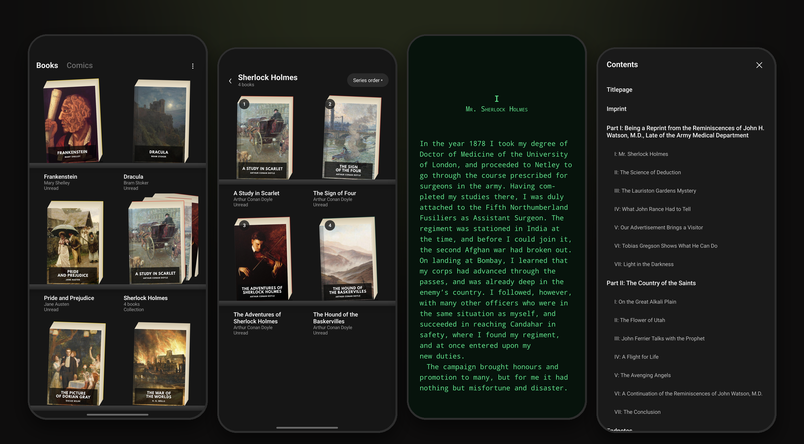
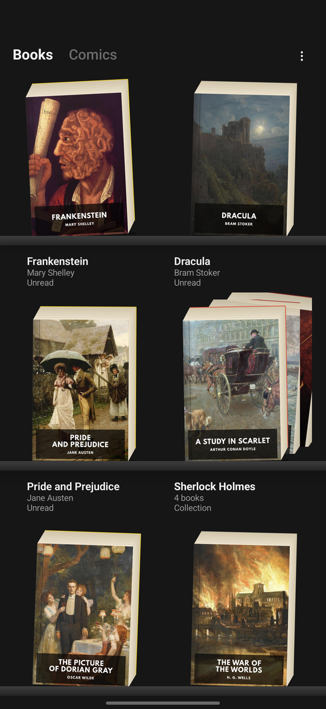
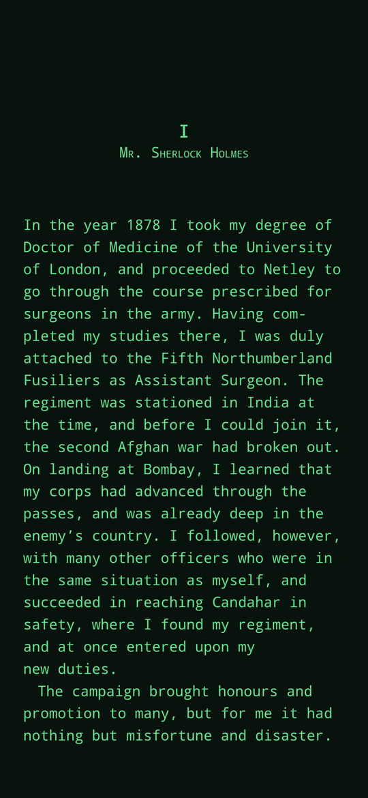
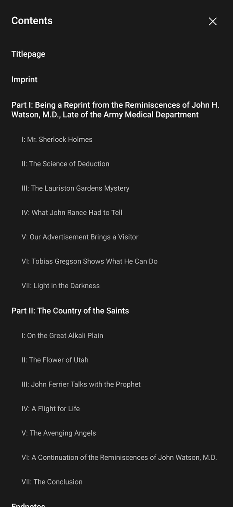

<div align="center">


# Spine

**A reading app that looks like a bookshelf and reads like it was designed on purpose.**

Reading apps are either clunky or boring. Spine is neither — your EPUBs stand on tilted-book shelves with their real covers, and every page is themeable down to the typeface.

[](#build-it)
[](https://kotlinlang.org)
[](https://developer.android.com/jetpack/compose)
[](https://readium.org/kotlin-toolkit)
[](#features)

<br />



</div>

<br />

## Features

- **A shelf, not a list.** Books stand on shelves, leaning at their own slight angles, drawn with the top of the pages visible over the cover. Covers, titles and authors come straight from each book's metadata.
- **Collections.** A series is one book on the shelf: a small stack of its covers. Tap it to open the collection, with every book numbered in reading order. Spine groups books for you from their series metadata, a sub-folder, or a shared title ("Harry Potter 4 - …"), and never makes a collection out of a single book. To build your own, long-press a book, tap more, and hit **Group…**.
- **Order that makes sense.** Sort a collection by series order, release date or A–Z, or nudge books earlier and later by hand. Books with no number in their metadata fill the gaps in the sequence, so an unnumbered book 1 lands where it belongs.
- **Four reading themes, applied live.** Midnight, Parchment, Terminal and Paper each change page colour, text colour, typeface, line height and alignment together. Switch mid-chapter and the page re-flows instantly.
- **A reader that stays out of the way.** Full-screen, no chrome. Tap the edges to turn pages, tap the middle for the panel.
- **Know where you are.** A progress slider you can drag, the current chapter name, and a full table of contents with nested parts.
- **Remembers everything.** Reading position per book, your theme and font size, and a shelf ordered by what you read last.
- **Clean titles, automatically.** File-derived metadata is a mess ("Rowling, J.K - Harry Potter 03 - Harry Potter and the Prisoner of Azkaban [some-site.com]"). Spine strips the brackets, author prefixes, series numbers and edition noise offline, then matches each book on [Open Library](https://openlibrary.org) for its proper title, author and first-publication year, which also powers release-date sorting. You can rename any book by hand, and the lookup can be switched off.
- **Local and private.** It reads the EPUBs in a folder on your phone. No account and no telemetry. The only network use is the optional Open Library lookup, which sends a book's title and its author's surname and nothing else.

## Screenshots

<table>
  <tr>
    <td align="center"><br /><sub>The shelf</sub></td>
    <td align="center"><br /><sub>Parchment</sub></td>
    <td align="center"><br /><sub>Terminal</sub></td>
    <td align="center"><br /><sub>Chapters</sub></td>
  </tr>
</table>

## How it works

| Layer | What it does |
| --- | --- |
| **Readium Kotlin toolkit** | Parses EPUBs and renders them (pagination, positions, locators). Spine does not reinvent the hard parts. |
| **Theme engine** | A theme is a set of tokens (`bg`, `text`, `font`, `lineHeight`, `margins`, `align`) pushed to the page as Readium preferences. Adding a theme is one line in `ReaderTheme.kt`. |
| **Shelf renderer** | `BookCover.kt` draws each book on a Compose `Canvas`: the cover art, a foreshortened page-top and a fore-edge, plus a stable per-book lean. |
| **Library scanner** | Walks `Documents/Books`, reads metadata and covers with Readium, caches covers as JPEGs and metadata as JSON so launches are instant. |
| **Title cleanup** | `Titles.kt` cleans names offline; `OpenLibrary.kt` fuzzy-matches the result against Open Library and keeps the proper title, author and year in the cache. |

```
app/src/main/java/app/spine/
├── MainActivity.kt          shelf host
├── ui/                      shelf, book model, canvas cover drawing
├── library/                 folder scan, metadata + cover cache, view model
└── reader/                  Readium navigator, themes, reader panel
```

## Build it

You need the Android SDK (platform 35) and a JDK between 17 and 21.

```sh
git clone git@github.com:0sian/Spine.git
cd Spine
echo "sdk.dir=$HOME/Android/Sdk" > local.properties   # your SDK path
./gradlew assembleDebug
adb install -r app/build/outputs/apk/debug/app-debug.apk
```

Put your `.epub` files in `Documents/Books` on the phone. For a series, rely on the books' own metadata, drop them in a sub-folder (`Documents/Books/Harry Potter/`), or select them in the app and group them by hand. On first launch Spine asks for **All files access**, because Android's folder picker refuses to hand out that folder. Grant it once and the shelf fills itself.

## Roadmap

- [ ] PDF support
- [ ] Custom themes (edit colours, fonts and spacing in-app; share as JSON)
- [ ] Themes generated from a book's cover colours
- [ ] Bookmarks and highlights
- [ ] Rename collections and pick their cover
- [ ] Choose any library folder

## License

[MIT](LICENSE)

## Credits

Built on the [Readium Kotlin toolkit](https://github.com/readium/kotlin-toolkit).
